# Doctor Tracker

A secure admin web app for managing **doctors** and the **patients** assigned to them, with a live analytics dashboard.

## Elevator Pitch

Hospital admins need to answer three questions quickly: _who are our doctors, who are their patients, and what is the workload right now?_ Doctor Tracker answers them in one place, and gives the public a simple way to find a doctor:

- **Public directory** (no login): anyone can find a doctor by name, hospital or specialization and open a profile. It shows only name, specialization and hospital, never contact details or patient data.
- **Hospital switcher**: pick a hospital in the sidebar and the dashboard, doctors and patients all narrow to it (or stay on "All hospitals").
- **Doctors**: searchable, filterable, sortable directory; each doctor has a detail page listing their patients, where patients can be admitted or removed.
- **Patients**: a hospital-wide patient list with search, condition/gender/doctor/date filters, sorting, edit and delete.
- **Dashboard**: headline numbers, admissions over time, workload per doctor, condition mix and specialization mix, each chart with an accessible table view.
- **Secure by default**: httpOnly cookie sessions with refresh-token rotation, rate-limited login, validated input on every route.
- **Built to stay fast**: server-side pagination everywhere, every list/filter/dashboard query is index-backed (proof in [Technical Decisions](#technical-decisions)).

**Stack**: Next.js 16 (App Router) · TypeScript · Tailwind v4 + shadcn/ui · TanStack Query · React Hook Form + Zod · Recharts · Express 5 · Mongoose 9 · MongoDB.

---

## Setup Guide

### Prerequisites

- **[Bun](https://bun.sh) 1.3+** (package manager and script runner) and **Node.js 22+** (Next.js and the production API image run on Node)
- **MongoDB 8** running locally, or a free [Atlas](https://cloud.mongodb.com) cluster. The quickest local option is Docker:

  ```bash
  docker run -d --name doctor-tracker-mongo -p 27017:27017 mongo:8.2
  ```

### 1. Install

```bash
git clone https://github.com/sranik28/Doctor-Tracker.git
cd Doctor-Tracker
bun run install:all
```

### 2. Configure environment

```bash
cp server/.env.example server/.env
cp client/.env.example client/.env.local
```

The defaults work as-is for local development (the server starts with the example placeholders outside production). It validates every variable at startup and **refuses to start in production** with placeholder or identical JWT secrets. To use real secrets, generate two and paste them into `server/.env` as `JWT_ACCESS_SECRET` and `JWT_REFRESH_SECRET` (run the command twice):

```bash
node -e "console.log(require('crypto').randomBytes(48).toString('hex'))"
```

| File                | Variable                                              | Purpose                                           | Default                                                 |
| ------------------- | ----------------------------------------------------- | ------------------------------------------------- | ------------------------------------------------------- |
| `server/.env`       | `MONGODB_URI`                                         | Mongo connection string                           | `mongodb://localhost:27017/doctor-tracker`              |
|                     | `JWT_ACCESS_SECRET`, `JWT_REFRESH_SECRET`             | token signing secrets (32+ chars, different)      | placeholders (fine locally, **rejected in production**) |
|                     | `ACCESS_TOKEN_EXPIRES_IN`, `REFRESH_TOKEN_EXPIRES_IN` | session lifetimes                                 | `15m`, `7d`                                             |
|                     | `CLIENT_URL`                                          | CORS origin                                       | `http://localhost:3000`                                 |
|                     | `PORT`                                                | API port                                          | `5000`                                                  |
|                     | `COOKIE_DOMAIN`, `TRUST_PROXY`                        | optional, see [DEPLOY.md](DEPLOY.md)              | empty, `1`                                              |
|                     | `SEED_ADMIN_EMAIL`, `SEED_ADMIN_PASSWORD`             | the first admin account created by `bun run seed` | see below                                               |
| `client/.env.local` | `API_INTERNAL_URL`                                    | where Next.js proxies `/api/*`                    | `http://localhost:5000`                                 |

### 3. Seed the database

```bash
bun run --cwd server seed        # creates indexes + the admin user (safe to re-run)
bun run --cwd server seed:demo   # optional: ~30 doctors and ~1,500 patients for the dashboard
```

### 4. Run

```bash
bun run dev
```

- App: <http://localhost:3000>
- API: <http://localhost:5000/api/health>

### Default admin login

|          |                             |
| -------- | --------------------------- |
| Email    | `admin@doctortracker.dev`   |
| Password | `change-me-strong-password` |

These come from `SEED_ADMIN_EMAIL` / `SEED_ADMIN_PASSWORD` in `server/.env`; change them before seeding anything that is reachable from the internet.

### Useful commands

| Command (repo root)                       | What it does                                         |
| ----------------------------------------- | ---------------------------------------------------- |
| `bun run dev`                             | API and client together, with reload                 |
| `bun run lint` · `bun run typecheck`      | ESLint and `tsc` for both apps                       |
| `bun run format` · `bun run format:check` | Prettier                                             |
| `bun run build`                           | production build of both apps                        |
| `bun run --cwd server explain`            | prints MongoDB `explain()` plans for every key query |
| `bun run --cwd client analyze`            | Next.js bundle analyzer                              |

Production: see [DEPLOY.md](DEPLOY.md) (Atlas + Docker API on Render/Railway/Coolify + client on Vercel).

---

## System Architecture

### Overview

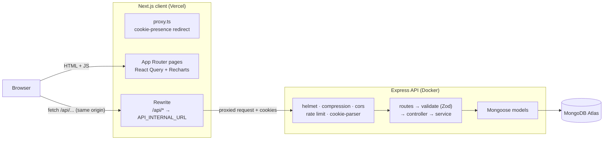

The browser only ever talks to the client's origin. Next.js forwards `/api/*` to Express, so the auth cookies are first-party.

### Authentication flow

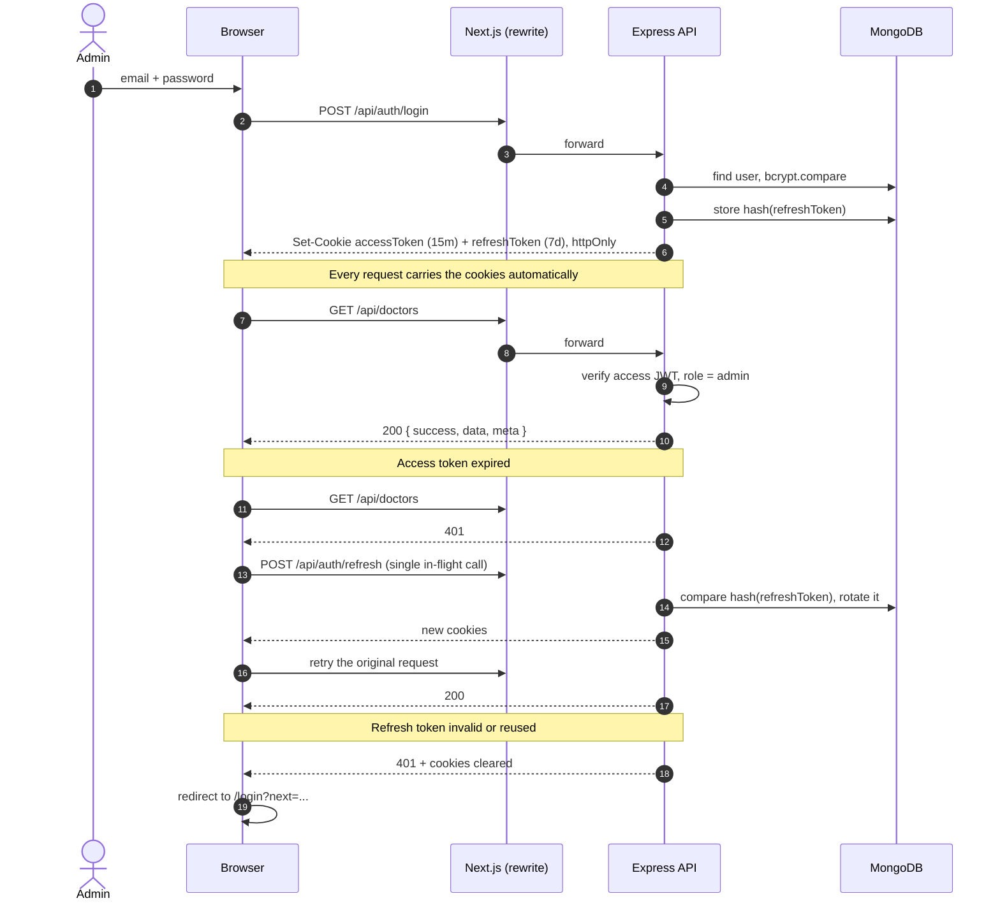

- Tokens live only in **httpOnly, `SameSite=Lax`, `Secure` (production)** cookies, never reachable from JavaScript.
- The refresh token is **rotated** on every use and only its **hash** is stored on the user, so a database leak does not leak sessions and a replayed token is rejected.
- Login is limited to 5 failed attempts per IP and 10 per account per 15 minutes.
- `proxy.ts` redirects on cookie _presence_ for speed; the real session check is the dashboard layout calling `/api/auth/me`.

### Folder structure

```
.
├── client/                      Next.js 16 app (App Router, src/)
│   └── src/
│       ├── app/
│       │   ├── (public)/                public site, no login
│       │   │   ├── page.tsx             landing + search
│       │   │   └── find-doctors/ + [id]/ directory + profile
│       │   ├── (auth)/login/            login page
│       │   ├── (dashboard)/             authenticated shell
│       │   │   ├── dashboard/           analytics
│       │   │   ├── doctors/ + [id]/     list + detail
│       │   │   └── patients/            list
│       │   ├── error.tsx, not-found.tsx, global-error.tsx
│       │   └── providers.tsx            React Query, theme, toasts
│       ├── components/
│       │   ├── ui/                      shadcn primitives
│       │   ├── layout/ shared/          shadcn sidebar + hospital switcher, pagination, empty/error states
│       │   ├── charts/ dashboard/       Recharts wrappers, stat cards
│       │   └── auth/ doctors/ patients/ public/ feature components
│       ├── hooks/                       React Query hooks, URL-filter state
│       ├── lib/                         axios instance, query keys, formatters
│       ├── schemas/                     Zod schemas shared by forms
│       ├── types/                       API response types
│       └── proxy.ts                     optimistic auth redirects
├── server/                      Express 5 API
│   ├── Dockerfile               multi-stage, non-root, healthcheck
│   └── src/
│       ├── config/              env (Zod, fail-fast), db
│       ├── routes/              URL → middleware → controller
│       ├── validations/         Zod schemas for body/query/params
│       ├── controllers/         HTTP in/out only
│       ├── services/            business logic and all queries
│       ├── models/              Mongoose schemas + indexes
│       ├── middlewares/         auth, authorize, validate, rate-limit, errors
│       ├── utils/               ApiError, response envelope, cookies, cache
│       ├── scripts/             seed, seed-demo, explain-report
│       ├── app.ts               middleware stack
│       └── server.ts            connect DB, listen, graceful shutdown
├── DEPLOY.md                    deployment guide
└── docs/screenshots/            images used below
```

### API reference

Base path `/api`. Every response uses one envelope: `{ success: true, data, meta? }` or `{ success: false, error: { code, message, details? } }`. All routes except `health`, `auth/login`, `auth/refresh` and `public/*` require an authenticated **admin**. The anonymous `public/*` routes are read-only, rate limited (120 requests/IP/minute), `limit` is capped at 24, and they return only `_id`, `name`, `specialization` and `hospital`. Lists are paginated server-side (`page`, `limit`: default 10, max 50).

| Method | Path                               | Description                                                                                                  |
| ------ | ---------------------------------- | ------------------------------------------------------------------------------------------------------------ |
| GET    | `/health`                          | liveness check                                                                                               |
| POST   | `/auth/login`                      | email + password → sets cookies (rate limited)                                                               |
| POST   | `/auth/refresh`                    | rotates the refresh token, issues new cookies                                                                |
| POST   | `/auth/logout`                     | revokes the refresh token, clears cookies                                                                    |
| GET    | `/auth/me`                         | the signed-in user                                                                                           |
| GET    | `/doctors`                         | list; `search`, `specialization`, `hospital`, `from`, `to`, `sort`, `page`, `limit`; includes `patientCount` |
| POST   | `/doctors`                         | create a doctor                                                                                              |
| GET    | `/doctors/filters/options`         | specializations and hospitals for filter dropdowns                                                           |
| GET    | `/doctors/:id`                     | one doctor with patient count                                                                                |
| GET    | `/doctors/:id/patients`            | that doctor's patients (paginated)                                                                           |
| POST   | `/doctors/:id/patients`            | admit a patient to this doctor                                                                               |
| DELETE | `/doctors/:id/patients/:patientId` | remove a patient from this doctor                                                                            |
| GET    | `/patients`                        | list; `search`, `condition`, `gender`, `doctorId`, `hospital`, `from`, `to`, `sort`, `page`, `limit`         |
| GET    | `/patients/filters/options`        | conditions for filter dropdowns                                                                              |
| GET    | `/patients/:id`                    | one patient with their doctor                                                                                |
| PATCH  | `/patients/:id`                    | update a patient (including reassigning the doctor)                                                          |
| DELETE | `/patients/:id`                    | delete a patient                                                                                             |
| GET    | `/dashboard/stats`                 | totals and this-month vs last-month figures (all `/dashboard/*` routes accept an optional `hospital`)        |
| GET    | `/dashboard/timeline`              | admissions over time (7d / 30d / 12m, zero-filled)                                                           |
| GET    | `/dashboard/patients-per-doctor`   | top doctors by patient count                                                                                 |
| GET    | `/dashboard/conditions`            | patients by condition                                                                                        |
| GET    | `/dashboard/specializations`       | doctors by specialization                                                                                    |
| GET    | `/dashboard/recent-patients`       | latest admissions                                                                                            |
| GET    | `/public/doctors`                  | public directory: `search`, `specialization`, `hospital`, `sort`, `page`, `limit` (no auth)                  |
| GET    | `/public/doctors/filters/options`  | specializations and hospitals for the public filters (no auth)                                               |
| GET    | `/public/doctors/:id`              | one doctor's public profile (no auth)                                                                        |

There is deliberately **no doctor delete endpoint**: it is not part of the requirements, and deleting a doctor would orphan their patients.

---

## Technical Decisions

### 1. A separate Express API instead of Next.js route handlers

**The tension in the spec.** The task is explicit about the stack: _Next.js as a separate client application_ and _Node.js + Express as a separate standalone server_, talking over REST. It also lists "best practices in Next.js" as an evaluation criterion, and modern Next.js makes it tempting to skip the second app entirely (route handlers, Server Actions, a data layer inside the same project). I followed the spec literally: two apps, `/client` and `/server`, and the API is only ever reached over HTTP. The real decision was _how to connect them_ without the usual costs of a split architecture, which is the rewrite proxy below. Here is what the separate API buys compared with the Next.js-only alternative:

**Why a separate API wins here**

|                        | Separate Express API (chosen)                                                                    | Next.js route handlers only                                                                                                    |
| ---------------------- | ------------------------------------------------------------------------------------------------ | ------------------------------------------------------------------------------------------------------------------------------ |
| Long-lived connections | one Mongoose pool per process, reused for the process lifetime                                   | on serverless, each cold instance opens its own pool; Atlas M0 caps at 500 connections, so a traffic burst can exhaust it      |
| Middleware             | the whole Express ecosystem (helmet, `express-rate-limit`, compression, cors) with no adaptation | re-implemented per route or in the proxy file; rate limiting needs an external store on serverless because memory isn't shared |
| Scaling                | scale the API and the UI independently                                                           | coupled                                                                                                                        |
| Testing & reuse        | the API is framework-agnostic: a mobile app or script can call it                                | tied to Next.js                                                                                                                |
| Layering               | routes → validate → controller → service → model, unchanged for any client                       | possible, but drifts toward fat route files                                                                                    |
| Cost                   | two deployments, one extra network hop                                                           | one deployment                                                                                                                 |

The extra hop and second deployment are the price. The next decision removes the other usual cost of a split architecture (cross-origin cookies).

**The rewrite proxy (and the cookie decision).** The client never calls the API's origin. It calls its _own_ origin at `/api/...`, and `next.config.ts` rewrites that to `API_INTERNAL_URL`:

```ts
async rewrites() {
  return [{ source: '/api/:path*', destination: `${apiInternalUrl}/api/:path*` }];
}
```

Consequences:

- **Cookies are first-party.** `Set-Cookie` from Express is forwarded to the browser as a response from the Vercel origin, so the cookies are _host-only_ (no `Domain`). This sidesteps `SameSite=None` and third-party-cookie blocking (Safari ITP, Chrome's phase-out) that break a cross-site API on a different domain. That is why `COOKIE_DOMAIN` stays **empty** in deployment.
- **No CORS in the browser path.** Same origin means no preflight round trips; CORS stays configured on Express only as defence in depth.
- **`SameSite=Lax` is enough** for CSRF protection of the state-changing requests, with no CSRF tokens needed.
- **The API origin is never exposed** to the browser and needs no `NEXT_PUBLIC_*` variable.
- **Trade-off: the destination is baked in at `next build`.** Changing the API URL needs a redeploy, and the build prints a warning if `API_INTERNAL_URL` is unset in production. I verified the production build proxies correctly against a containerised API.

### 2. MongoDB: patients _reference_ doctors (not embedded)

A `Patient` stores `doctorId` and the doctor is looked up when needed. Patients are **not** embedded in the doctor document.

| Concern                                                  | Reference (chosen)                                                          | Embed patients in doctor                                                                   |
| -------------------------------------------------------- | --------------------------------------------------------------------------- | ------------------------------------------------------------------------------------------ |
| Growth                                                   | doctor documents stay tiny                                                  | unbounded array; 16 MB document limit, and every patient write rewrites a growing document |
| Hospital-wide patient list, search, filters, date ranges | one indexed collection                                                      | needs `$unwind` over every doctor: no useful indexes, no cheap pagination                  |
| Patient edit / delete / reassign                         | single small document update                                                | positional array updates, and moving a patient between doctors is a two-document write     |
| Dashboard aggregations                                   | `$group` over an index                                                      | `$unwind` first, then group                                                                |
| Reading one doctor + their patients                      | two indexed queries (counts come from one grouped query for the whole page) | one read                                                                                   |

Embedding only wins on "read one doctor with all patients", and that screen is paginated anyway. Patients are a high-volume, independently queried and independently updated entity, which is the textbook case for referencing. Patient _lists_ are enriched with the doctor via a `populate` of a virtual, loading only the fields the UI shows.

**Query rules applied everywhere**

- Server-side pagination with `limit` capped at 50: there are **no unbounded queries**.
- `.lean()` and explicit **projections**: no hydrated documents, no unused fields over the wire.
- **Counts without scans**: unfiltered totals use `estimatedDocumentCount()`; filtered totals are index-only `COUNT_SCAN`s.
- **N+1 avoided**: patient counts for a whole page of doctors come from one `$group` over the index.
- Dashboard aggregations are `$group`-first over **covered index scans** (forced with `hint`) and cached for 60 s.
- Dates are bucketed in the `Asia/Dhaka` timezone, and empty days/months are zero-filled so charts never have gaps.

**Index strategy**

| Collection | Index                                                        | Serves                                                         |
| ---------- | ------------------------------------------------------------ | -------------------------------------------------------------- |
| `patients` | `{ doctorId: 1, createdAt: -1 }`                             | a doctor's patients (newest first), per-doctor counts          |
|            | `{ doctorId: 1, admittedAt: -1 }`                            | patient list filtered by doctor                                |
|            | `{ condition: 1, admittedAt: -1 }`                           | condition filter, conditions chart                             |
|            | `{ gender: 1, admittedAt: -1 }`                              | gender filter and its count                                    |
|            | `{ admittedAt: -1 }`                                         | default list order, date ranges, timeline, recent patients     |
|            | `{ name: 1 }`                                                | A–Z / Z–A sort                                                 |
|            | text on `name`                                               | search box                                                     |
| `doctors`  | `{ email: 1 }` unique                                        | no duplicate doctors                                           |
|            | `{ createdAt: -1 }`, `{ name: 1 }`                           | default list, A–Z / Z–A sort                                   |
|            | `{ specialization: 1, createdAt: -1 }`                       | filter, specializations chart                                  |
|            | `{ hospital: 1, createdAt: -1 }`                             | hospital filter                                                |
|            | `{ specialization: 1, name: 1 }`, `{ hospital: 1, name: 1 }` | public directory filters, sorted A–Z without an in-memory sort |
|            | text on `name`, `hospital`                                   | search box                                                     |

Indexes cost write speed and memory, so there are only as many as there are query shapes. Two sorts are intentionally **not** indexed: sorting _all_ patients by age or by record-created date (shown below as documented trade-offs). They are rare admin actions and each would add a write-amplifying index; `limit` keeps the response small and the in-memory sort is bounded by the collection size. Index them if usage shows they matter.

**Proof: `bun run --cwd server explain`** (30 doctors, 1,500 patients, page size 10). The script exits non-zero if any key query uses a `COLLSCAN`. Result: **`OK: none of the 39 key queries use COLLSCAN.`** Plans read bottom-up (`IXSCAN` first). `PROJECTION_COVERED` means the query was answered from the index alone, with zero documents fetched.

#### Doctors

| Query                              | Plan                                                                    | Index                         | nReturned | docsExamined |  ms |
| ---------------------------------- | ----------------------------------------------------------------------- | ----------------------------- | --------: | -----------: | --: |
| doctors: default list              | LIMIT < PROJECTION_SIMPLE < FETCH < IXSCAN                              | createdAt_-1                  |        10 |           10 |   0 |
| doctors: sort by name              | LIMIT < PROJECTION_SIMPLE < FETCH < IXSCAN                              | name_1                        |        10 |           10 |   0 |
| doctors: specialization            | LIMIT < PROJECTION_SIMPLE < FETCH < IXSCAN                              | specialization_1_createdAt_-1 |         4 |            4 |   0 |
| doctors: hospital                  | LIMIT < PROJECTION_SIMPLE < FETCH < IXSCAN                              | hospital_1_createdAt_-1       |         3 |            3 |   0 |
| doctors: created date range        | LIMIT < PROJECTION_SIMPLE < FETCH < IXSCAN                              | createdAt_-1                  |        10 |           10 |   0 |
| doctors: text search ("Halvorson") | PROJECTION_SIMPLE < SORT < TEXT_MATCH < FETCH < IXSCAN (in-memory sort) | doctor_text_search            |         1 |            1 |   0 |
| doctors: count (specialization)    | GROUP < COUNT_SCAN                                                      | specialization_1_createdAt_-1 |         1 |            0 |   0 |

#### Public directory

| Query                             | Plan                                                                    | Index                   | nReturned | docsExamined |  ms |
| --------------------------------- | ----------------------------------------------------------------------- | ----------------------- | --------: | -----------: | --: |
| public: default list (A-Z)        | LIMIT < PROJECTION_SIMPLE < FETCH < IXSCAN                              | name_1                  |        10 |           10 |   0 |
| public: specialization            | LIMIT < PROJECTION_SIMPLE < FETCH < IXSCAN                              | specialization_1_name_1 |         4 |            4 |   0 |
| public: hospital                  | LIMIT < PROJECTION_SIMPLE < FETCH < IXSCAN                              | hospital_1_name_1       |         3 |            3 |   0 |
| public: recently joined           | LIMIT < PROJECTION_SIMPLE < FETCH < IXSCAN                              | createdAt_-1            |        10 |           10 |   0 |
| public: text search ("Halvorson") | PROJECTION_SIMPLE < SORT < TEXT_MATCH < FETCH < IXSCAN (in-memory sort) | doctor_text_search      |         1 |            1 |   0 |

#### Patients

| Query                                           | Plan                                                                    | Index                     | nReturned | docsExamined |  ms |
| ----------------------------------------------- | ----------------------------------------------------------------------- | ------------------------- | --------: | -----------: | --: |
| patients: default list                          | LIMIT < PROJECTION_SIMPLE < FETCH < IXSCAN                              | admittedAt_-1             |        10 |           10 |   0 |
| patients: condition                             | LIMIT < PROJECTION_SIMPLE < FETCH < IXSCAN                              | condition_1_admittedAt_-1 |        10 |           10 |   0 |
| patients: doctor                                | LIMIT < PROJECTION_SIMPLE < FETCH < IXSCAN                              | doctorId_1_admittedAt_-1  |        10 |           10 |   0 |
| patients: admitted date range                   | LIMIT < PROJECTION_SIMPLE < FETCH < IXSCAN                              | admittedAt_-1             |        10 |           10 |   0 |
| patients: gender                                | LIMIT < PROJECTION_SIMPLE < FETCH < IXSCAN                              | gender_1_admittedAt_-1    |        10 |           10 |   0 |
| patients: text search ("Raynor")                | PROJECTION_SIMPLE < SORT < TEXT_MATCH < FETCH < IXSCAN (in-memory sort) | patient_text_search       |         5 |            5 |   0 |
| patients: condition + date range                | LIMIT < PROJECTION_SIMPLE < FETCH < IXSCAN                              | condition_1_admittedAt_-1 |        10 |           10 |   0 |
| patients: sort by name                          | LIMIT < PROJECTION_SIMPLE < FETCH < IXSCAN                              | name_1                    |        10 |           10 |   0 |
| patients: count (condition)                     | GROUP < COUNT_SCAN                                                      | condition_1_admittedAt_-1 |         1 |            0 |   0 |
| doctor page: a doctor's patients (newest first) | LIMIT < PROJECTION_SIMPLE < FETCH < IXSCAN                              | doctorId_1_createdAt_-1   |        10 |           10 |   0 |
| list: patient counts for a page of doctors      | GROUP < PROJECTION_COVERED < IXSCAN                                     | doctorId_1_createdAt_-1   |         1 |            0 |   1 |

#### Dashboard

| Query                           | Plan                                       | Index                         | nReturned | docsExamined |  ms |
| ------------------------------- | ------------------------------------------ | ----------------------------- | --------: | -----------: | --: |
| dashboard: stats (month facets) | PROJECTION_COVERED < IXSCAN                | admittedAt_-1                 |       441 |            0 |   1 |
| dashboard: timeline 7d          | GROUP < PROJECTION_COVERED < IXSCAN        | admittedAt_-1                 |         7 |            0 |   0 |
| dashboard: timeline 30d         | GROUP < PROJECTION_COVERED < IXSCAN        | admittedAt_-1                 |        28 |            0 |   1 |
| dashboard: timeline 12m         | GROUP < PROJECTION_COVERED < IXSCAN        | admittedAt_-1                 |        12 |            0 |   3 |
| dashboard: patients per doctor  | GROUP < PROJECTION_COVERED < IXSCAN        | doctorId_1_admittedAt_-1      |        30 |            0 |   3 |
| dashboard: conditions           | GROUP < PROJECTION_COVERED < IXSCAN        | condition_1_admittedAt_-1     |        12 |            0 |   1 |
| dashboard: specializations      | GROUP < PROJECTION_COVERED < IXSCAN        | specialization_1_createdAt_-1 |         8 |            0 |   0 |
| dashboard: recent patients      | LIMIT < PROJECTION_SIMPLE < FETCH < IXSCAN | admittedAt_-1                 |        10 |           10 |   0 |

#### Hospital switcher (scoped to one hospital)

| Query                                     | Plan                                                                      | Index                    | nReturned | docsExamined |  ms |
| ----------------------------------------- | ------------------------------------------------------------------------- | ------------------------ | --------: | -----------: | --: |
| hospital: patients list (Square Hospital) | LIMIT < PROJECTION_SIMPLE < FETCH < SORT_MERGE < IXSCAN < IXSCAN < IXSCAN | doctorId_1_admittedAt_-1 |        10 |           10 |   0 |
| hospital: patients count                  | GROUP < IXSCAN                                                            | doctorId_1_createdAt_-1  |         1 |            0 |   0 |
| hospital: dashboard stats                 | PROJECTION_COVERED < IXSCAN                                               | doctorId_1_admittedAt_-1 |        37 |            0 |   0 |
| hospital: timeline 30d                    | GROUP < PROJECTION_COVERED < IXSCAN                                       | doctorId_1_admittedAt_-1 |        15 |            0 |   1 |
| hospital: patients per doctor             | GROUP < PROJECTION_COVERED < IXSCAN                                       | doctorId_1_createdAt_-1  |         3 |            0 |   1 |
| hospital: conditions                      | GROUP < FETCH < IXSCAN                                                    | doctorId_1_createdAt_-1  |        12 |          154 |   1 |
| hospital: specializations                 | GROUP < FETCH < IXSCAN                                                    | hospital_1_createdAt_-1  |         3 |            3 |   0 |
| hospital: recent patients                 | LIMIT < PROJECTION_SIMPLE < FETCH < SORT_MERGE < IXSCAN < IXSCAN < IXSCAN | doctorId_1_admittedAt_-1 |        10 |           10 |   0 |

#### Documented trade-offs (intentionally not indexed)

| Query                                     | Plan                                           | Index | nReturned | docsExamined |  ms |
| ----------------------------------------- | ---------------------------------------------- | ----- | --------: | -----------: | --: |
| patients: sort by age (no index)          | PROJECTION_SIMPLE < SORT < COLLSCAN ⚠ COLLSCAN | -     |        10 |         1500 |   1 |
| patients: sort by created date (no index) | PROJECTION_SIMPLE < SORT < COLLSCAN ⚠ COLLSCAN | -     |        10 |         1500 |   1 |

> The text-search rows include an in-memory `SORT` over the (small) set of text matches, which is how MongoDB combines `$text` with a sort. Timings are from a small local dataset and only meaningful relative to `docsExamined`, which is what scales.

### 3. Other decisions

| Decision                   | Choice                                                                                                                                                                                               | Why                                                                                                                                                                                       |
| -------------------------- | ---------------------------------------------------------------------------------------------------------------------------------------------------------------------------------------------------- | ----------------------------------------------------------------------------------------------------------------------------------------------------------------------------------------- |
| Session storage            | httpOnly cookies, not `localStorage`                                                                                                                                                                 | tokens are unreachable from XSS; the browser attaches them automatically                                                                                                                  |
| Access + refresh tokens    | 15 min / 7 d, refresh **rotated**, hash stored                                                                                                                                                       | short blast radius for a stolen access token; reuse of a rotated refresh token is rejected                                                                                                |
| Phone numbers              | a country-aware phone field (`react-phone-number-input`), validated with `libphonenumber-js` on **both** the client and the API using the same metadata, and stored in E.164 (`+8801711123456`)      | a number is accepted only if it is a real number for its country, one canonical stored format, formatted for display; the field's code and flags load lazily when a form opens            |
| Hospital switcher          | the hospital is chosen in the sidebar, saved in `localStorage` and sent as a `hospital` query param; the API resolves it to that hospital's doctor ids and matches patients with `doctorId: { $in }` | hospital lives on the doctor, so this avoids a `$lookup` per query and stays on the `doctorId_1_*` indexes (see the "Hospital switcher" explain table)                                    |
| Public directory           | separate `/api/public/*` router with its own projection (no phone/email, no patient counts), `Cache-Control: public, max-age=60`, its own rate limit                                                 | the admin routes stay admin-only and unchanged; a public response can never leak a field the projection omits                                                                             |
| Role check                 | `authorize('admin')` on every data router                                                                                                                                                            | the data routes are admin-only today, but the guard is already in place for more roles                                                                                                    |
| Validation                 | Zod on body, query _and_ params of every route; same Zod schemas power client forms                                                                                                                  | one source of truth for rules, consistent error shape (`details` per field)                                                                                                               |
| Error handling             | one `ApiError` type and a global handler; stack traces never leave the server in production                                                                                                          | predictable client handling, no information leaks                                                                                                                                         |
| Server state on the client | TanStack Query (cache, dedupe, retry, optimistic add/remove of a doctor's patients)                                                                                                                  | no hand-rolled fetching, and no global store needed: server state lives in the query cache, view state in the URL                                                                         |
| Filters in the URL         | `searchParams` own filter, sort and page state (`use-url-filters`)                                                                                                                                   | shareable and bookmarkable, back button works, survives reload                                                                                                                            |
| Charts                     | Recharts, code-split and loaded lazily; each chart has a data-table view and uses a colour-blind-safe palette                                                                                        | keeps Recharts out of the initial JS and charts accessible                                                                                                                                |
| Initial JS (gzip)          | ~294 KB landing, ~293 KB login, ~292 KB dashboard, ~310 KB public directory, ~396 KB doctors, ~399 KB patients                                                                                       | measured on the production build from each page's script tags; Recharts is not in any initial bundle, and the phone-number metadata (~30 KB) loads only on the doctors and patients pages |
| Dashboard cache            | in-process 60 s TTL cache, no invalidation                                                                                                                                                           | cheap and fine for a single instance; swap for Redis if the API is scaled horizontally                                                                                                    |
| Rate limiting              | in-memory `express-rate-limit`                                                                                                                                                                       | enough for one instance; use a shared store behind multiple instances                                                                                                                     |
| Liveness vs readiness      | `/api/health` does not touch the DB                                                                                                                                                                  | a database blip must not make the platform kill and restart healthy API containers                                                                                                        |
| Container                  | multi-stage, production deps only, non-root, `HEALTHCHECK`, `node dist/server.js` as PID-1 command                                                                                                   | clean `SIGTERM` handling for graceful shutdown                                                                                                                                            |
| Timezone                   | day/month buckets computed in `Asia/Dhaka`                                                                                                                                                           | "today" on the dashboard matches the admins' wall clock                                                                                                                                   |

---

## Visual Evidence

Screenshots live in [`docs/screenshots`](docs/screenshots). They are placeholders until the images are added with exactly these filenames.

### Desktop

| Login                                                  | Dashboard                                                      |
| ------------------------------------------------------ | -------------------------------------------------------------- |
| 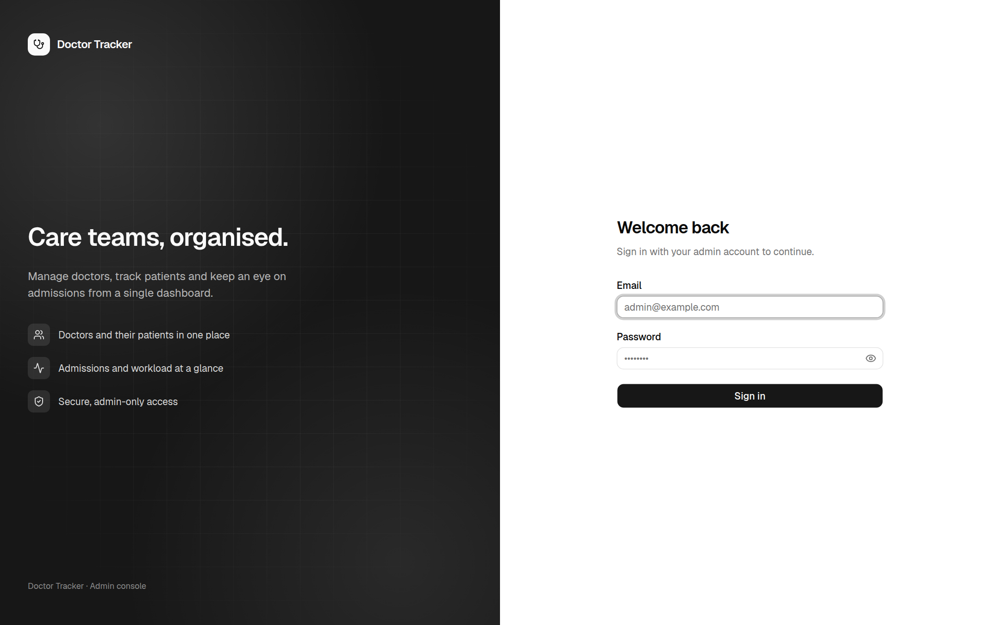 | 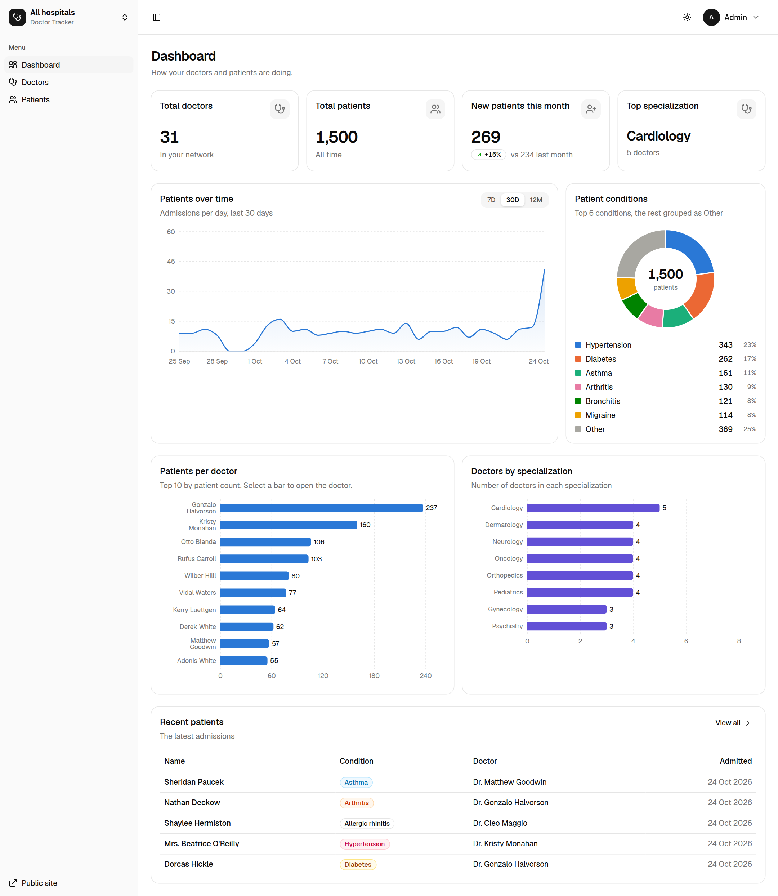 |

| Doctors                                                    | Doctor detail                                                          |
| ---------------------------------------------------------- | ---------------------------------------------------------------------- |
| 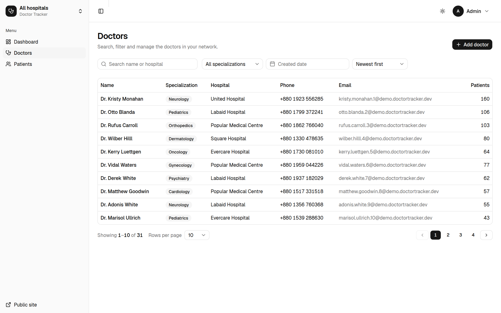 | 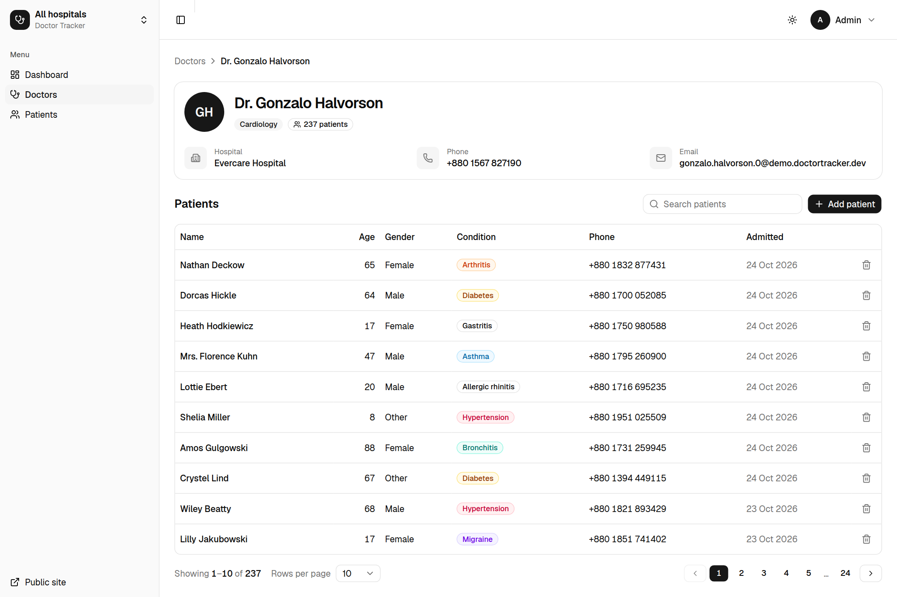 |

| Patients                                                     |
| ------------------------------------------------------------ |
| 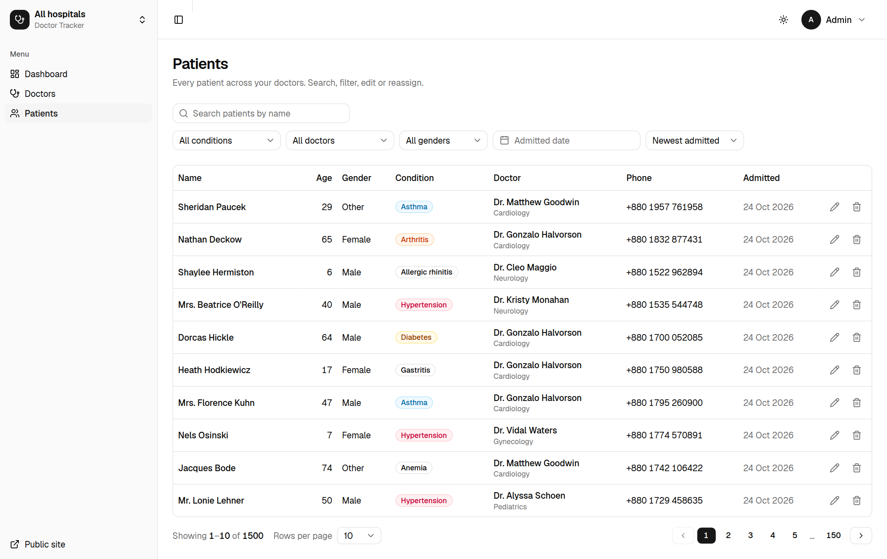 |

### Public site

| Landing (desktop)                                       | Find a doctor (desktop)                                               |
| ------------------------------------------------------- | --------------------------------------------------------------------- |
| 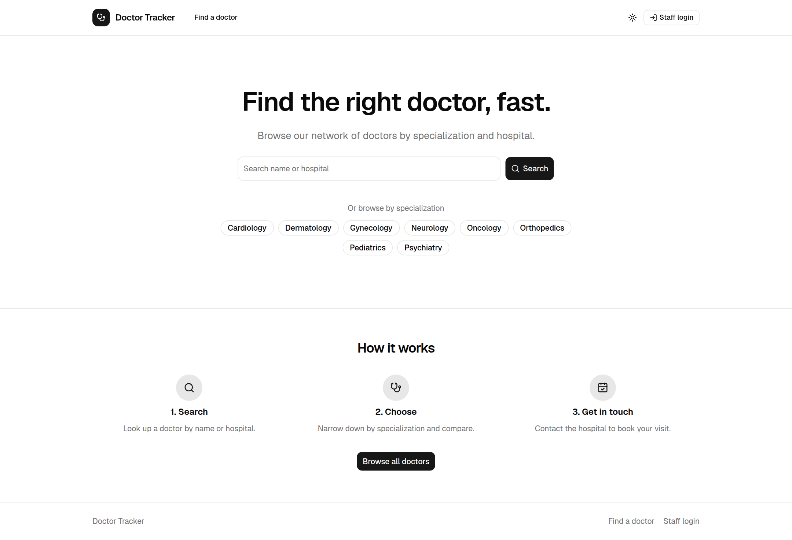 | 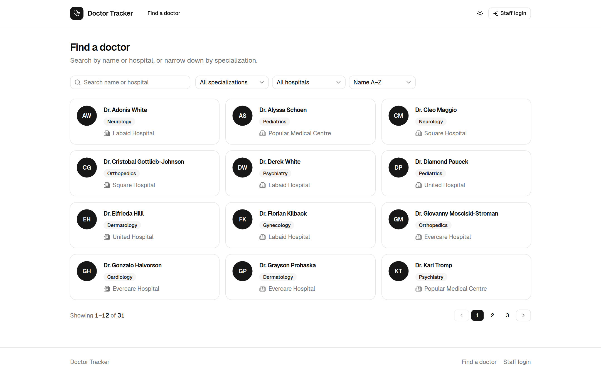 |

| Landing (mobile)                                      | Find a doctor (mobile)                                              |
| ----------------------------------------------------- | ------------------------------------------------------------------- |
| 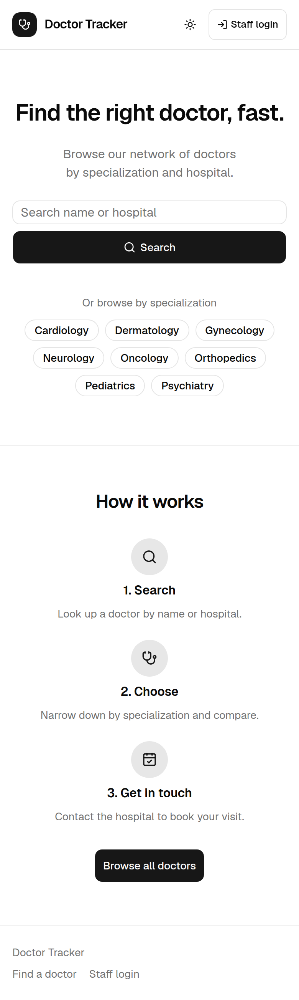 | 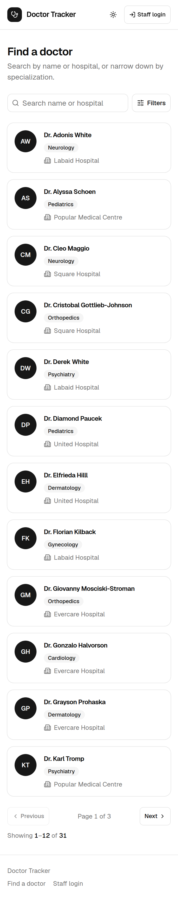 |

### Mobile

| Login                                                | Dashboard                                                    | Doctors                                                  | Doctor detail                                                        | Patients                                                   |
| ---------------------------------------------------- | ------------------------------------------------------------ | -------------------------------------------------------- | -------------------------------------------------------------------- | ---------------------------------------------------------- |
| 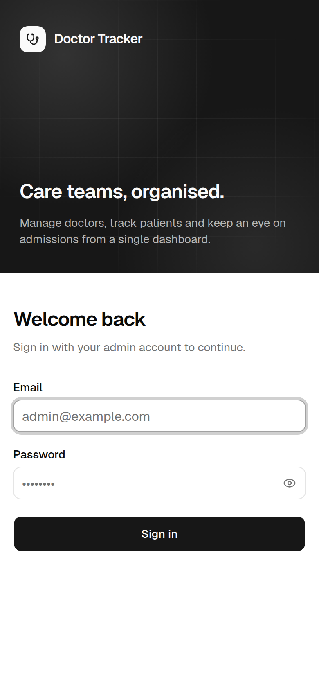 | 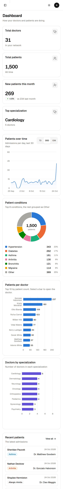 | 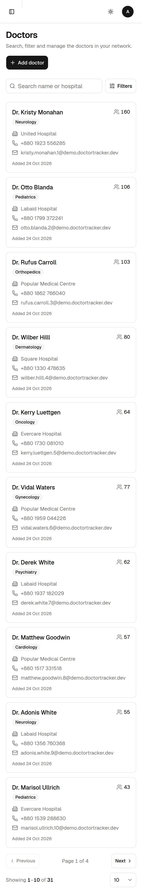 | 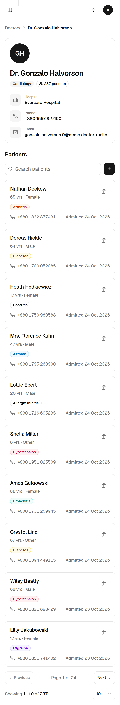 | 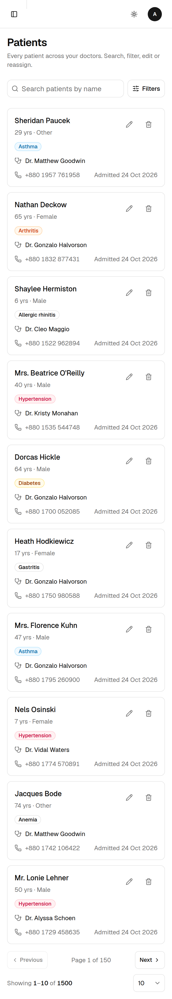 |

---

## Live Demo & Links

|                 |                                                       |
| --------------- | ----------------------------------------------------- |
| Live app        | _add the Vercel URL after deploying_                  |
| Live API health | _add `https://<api-host>/api/health` after deploying_ |
| Repository      | <https://github.com/sranik28/Doctor-Tracker>          |

**Demo credentials**: `admin@doctortracker.dev` / `change-me-strong-password` (use whatever `SEED_ADMIN_*` you seeded the live database with).

## Future Improvements

- **Tests**: API integration tests (Vitest + Supertest + `mongodb-memory-server`) and Playwright end-to-end flows for login and CRUD.
- **More roles** (doctor, receptionist) on top of the existing `authorize()` guard, plus an audit log of who changed what.
- **Shared rate-limit and cache store** (Redis) for running several API instances; cache invalidation on writes.
- **Keyset (cursor) pagination** for very deep patient lists; offset pagination is fine at this scale.
- **Doctor edit/archive** flow (soft delete so history is preserved) and patient transfer between doctors in bulk.
- **Observability**: structured logs, request IDs, metrics and error tracking.
- **CI**: GitHub Actions running lint, typecheck, build and `bun run explain` against a Mongo service container.
- **Internationalisation** and a printable/CSV export of patient lists.
